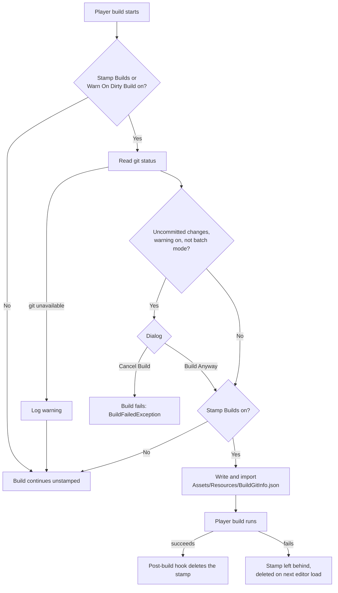

# Build Stamping

Part of the [Git Toolbar](README.md).

Every player build records which git branch and commit it was built from, and whether the working copy had uncommitted changes. The game can read this at runtime, so a bug report can say `develop@9ba2400*` instead of "the build from Tuesday".

## Contents

- [Files](#files)
- [Setup](#setup)
- [What gets stamped](#what-gets-stamped)
- [How it works](#how-it-works)
- [Reading the stamp at runtime](#reading-the-stamp-at-runtime)
- [Settings](#settings)
- [Limitations](#limitations)
- [Troubleshooting](#troubleshooting)

## Files

Paths are relative to the `Git Toolbar` folder.

| File | Assembly | Role |
|---|---|---|
| `Editor/GitBuildStamp.cs` | `GitToolbar.Editor` | Build hooks: uncommitted-changes check, writes and deletes the stamp. |
| `Runtime/BuildGitInfo.cs` | `GitToolbar.Runtime` | Data class, and `BuildGitInfo.Current` for reading the stamp. |
| `Editor/GitRepoStatus.cs` | `GitToolbar.Editor` | Runs git and parses the result (shared with the toolbar). |
| `Editor/GitToolbarSettings.cs` | `GitToolbar.Editor` | The two on/off settings. |

`GitToolbar.Runtime` is auto-referenced, so scripts in `Assembly-CSharp` can use `BuildGitInfo` directly. Scripts in your own assembly definitions need a reference to `GitToolbar.Runtime`.

## Setup

Build stamping is on by default once the Git Toolbar is in the project. One manual step is recommended: add the stamp file to your `.gitignore`, so a leftover from a failed build can never be committed (see [if a build fails midway](#5-if-a-build-fails-midway)):

```gitignore
# Git Toolbar build stamp, only exists while a player build runs
/Assets/Resources/BuildGitInfo.json
/Assets/Resources/BuildGitInfo.json.meta
```

## What gets stamped

A small JSON file, packed into the build as a `Resources` text asset:

```json
{
    "Branch": "develop",
    "Commit": "9ba2400",
    "IsDirty": true,
    "BuildTime": "2026-10-18T10:22:00.0000000Z"
}
```

| Field | Meaning |
|---|---|
| `Branch` | Checked-out branch. Empty when building from a detached HEAD. |
| `Commit` | First 7 characters of the HEAD commit hash. |
| `IsDirty` | `true` if there were staged, modified, untracked or conflicted files when the build started. |
| `BuildTime` | When the stamp was written, in UTC (ISO 8601). |

## How it works

`GitBuildStamp` implements Unity's `IPreprocessBuildWithReport` and `IPostprocessBuildWithReport`. Unity calls these for every player build, however it's started: **File → Build Profiles**, a custom build tool, or a CI script calling `BuildPipeline.BuildPlayer`.



### 1. Before the build: read git

If both settings are off, the hook does nothing.

Otherwise it calls `GitRepoStatus.Query()`, the same query the toolbar uses. It runs `git status --porcelain=v2 --branch` in the project folder and takes the branch name, HEAD commit and file counts from the output. This runs synchronously; it takes well under a second and is negligible next to a build.

If git can't be run (git not installed or not on `PATH`, the project isn't in a repository, or it's a ParrelSync clone), the hook logs a warning and returns. **The build continues unstamped**; stamping never fails a build.

```
[GitBuildStamp] Could not read git status - the build is not stamped.
```

### 2. Uncommitted-changes check

If **Warn On Dirty Build** is on and the working copy has changes, this dialog appears:

> **Uncommitted changes**
> You are building from "develop" with uncommitted changes (0 staged, 3 modified, 1 untracked). The build will not match any commit.
>
> **Build Anyway** / **Cancel Build**

- **Build Anyway** continues; the stamp gets `IsDirty: true`.
- **Cancel Build** throws a `BuildFailedException`, and Unity stops the build as a normal build failure.

> [!NOTE]
> The dialog is **never shown in batch mode** (`-batchmode`, `Application.isBatchMode`), so CI builds are never blocked waiting for a click. They're still stamped, with `IsDirty` set accordingly.

Untracked files count as changes. A stray new file nobody committed makes the build dirty, because that file may be part of the build.

### 3. Writing the stamp

If **Stamp Builds** is on, the hook:

1. Writes `Assets/Resources/BuildGitInfo.json`.
2. Imports it immediately (`AssetDatabase.ImportAsset` with `ForceSynchronousImport`), so Unity sees it as a `TextAsset` before it collects `Resources` for the build.
3. Logs the stamp:

```
[GitBuildStamp] Stamped build with develop@9ba2400*.
```

The file is around 150 bytes.

### 4. After the build: clean up

`OnPostprocessBuild` deletes the JSON and its `.meta` via `AssetDatabase.DeleteAsset`. The file only exists while a build is running.

### 5. If a build fails midway

Unity doesn't call post-build hooks when a build fails, so the file can be left behind. Two things handle that:

- **Next editor load:** `GitBuildStamp` has a static constructor (`[InitializeOnLoad]`) that deletes any leftover stamp after the editor finishes loading or recompiling, unless a build is in progress.
- **`.gitignore`:** with the lines from [setup](#setup), a leftover can't be committed and doesn't count as a change in the next build's uncommitted-changes check.

## Reading the stamp at runtime

```csharp
using GitToolbar;

var git = BuildGitInfo.Current;
if (git != null)
{
    Debug.Log($"Built from {git}");            // develop@9ba2400*
    Debug.Log($"Branch: {git.Branch}, commit: {git.Commit}, dirty: {git.IsDirty}, at {git.BuildTime}");
}
```

How `BuildGitInfo.Current` behaves:

- **In the editor it always returns `null`**, including Play mode. The stamp describes a build, not the editor session.
- In a build, it loads `Resources/BuildGitInfo` on first access, parses it with `JsonUtility`, unloads the text asset and caches the result. Later calls are free.
- It returns `null` in builds made with **Stamp Builds** off, or when git couldn't be read at build time.

`ToString()` gives the short form: `<branch>@<commit>`, with `detached` in place of the branch for a detached HEAD, and a trailing `*` when the build was dirty.

### Showing it in the game

The tool doesn't display the stamp anywhere by itself. A typical place is next to the version number:

```csharp
var git = BuildGitInfo.Current;
versionText.text = git != null ? $"{Application.version} ({git})" : Application.version;
// 1.4.0 (develop@9ba2400*)
```

It's also useful in logs attached to bug reports, or in an in-game debug console.

## Settings

**Edit → Project Settings → Git Toolbar**, or right-click the git toolbar element → **Toolbar Settings…**

| Setting | Default | Effect |
|---|---|---|
| Stamp Builds | On | Write the stamp into player builds. |
| Warn On Dirty Build | On | Show the uncommitted-changes dialog (never in batch mode). |

Settings are stored in `ProjectSettings/GitToolbarSettings.asset`, shared with the team through git. The file is created the first time you change a value; until then the defaults above apply.

## Limitations

- **Only player builds are stamped.** Addressables content built separately (e.g. a remote content update) isn't covered. The stamp tells you which commit the player binary came from, not which commit the currently downloaded Addressables content came from.
- **The commit may not exist on the server.** The stamp records your local HEAD. If you build before pushing, `Commit` points to a commit only you have until you push.
- **`IsDirty` only says *that* there were changes**, not which ones. A dirty build can't be reproduced exactly from the commit.
- **The working copy is read once, before the build.** Files changed while the build runs aren't reflected.
- **The short hash is fixed at 7 characters.** That's enough for most projects, but it isn't guaranteed unique the way `git rev-parse --short` is.

## Troubleshooting

| Symptom | Cause / fix |
|---|---|
| `BuildGitInfo.Current` is `null` in a build | Stamping was off, or git couldn't be read. Check the build log for the `[GitBuildStamp]` lines. |
| `BuildGitInfo.Current` is `null` in the editor | Expected; it only works in builds. |
| `BuildGitInfo` can't be found when compiling | Add `using GitToolbar;`. Scripts in your own assembly definition also need a reference to `GitToolbar.Runtime`. |
| CI builds are never stamped | `git` isn't on the build agent's `PATH`, or the checkout has no `.git` folder (e.g. a source archive instead of a clone). |
| The dialog appears but nothing looks changed | Untracked files count. Check `git status`, or hover the git toolbar element for the counts. |
| `Assets/Resources/BuildGitInfo.json` exists outside a build | A build failed after the stamp was written. It's removed on the next editor load or recompile; add it to `.gitignore` (see [setup](#setup)). |
