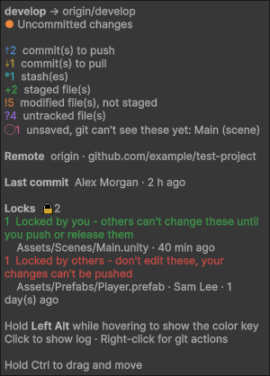
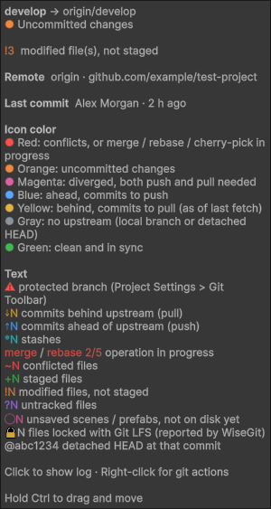
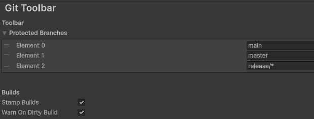

# Git Toolbar

Shows your git status in Unity's main toolbar, with common git actions on right-click. Built on [WiseGit](https://github.com/NibbleByte/UnityWiseGit).

## Requirements

- Unity 6.3 or newer
- git 2.35 or newer on `PATH`
- [WiseGit](https://github.com/NibbleByte/UnityWiseGit), with a git client set in **Assets → Git → Git Preferences**

## Installation

1. Install WiseGit.
2. Copy this repository into any folder under `Assets/`.

If the status doesn't show up, right-click the toolbar and enable **Version Control → Git Status**.

## Usage

- **Click** to open the log.
- **Right-click** to commit, pull, push, fetch, merge, stash and more.
- **Hover** for details. Hold <kbd>Left Alt</kbd> while hovering to also see what each color and symbol means.

<table>
  <tr>
    <td valign="top"></td>
    <td valign="top"></td>
  </tr>
</table>

$`{\color{#F85149}\text{⚠}}\ \text{develop}\ {\color{#E3B341}\text{⇣1}}{\color{#58A6FF}\text{⇡2}}\ {\color{#39C5CF}\text{*1}}\ {\color{#F85149}\text{merge}}\ {\color{#F85149}\mathord{\sim}\text{1}}\ {\color{#3FB950}\text{+2}}\ {\color{#F0883E}\text{!5}}\ {\color{#A371F7}\text{?4}}\ {\color{#DB61A2}\text{◌1}}\ \text{🔒}{\color{#8B949E}\text{2}}`$

| Symbol | Meaning |
|---|---|
| $`{\color{#F85149}\text{⚠}}`$ | Protected branch |
| $`{\color{#E3B341}\text{⇣N}}`$ $`{\color{#58A6FF}\text{⇡N}}`$ | Commits to pull / push, as of the last fetch |
| $`{\color{#39C5CF}\text{*N}}`$ | Stashes |
| $`{\color{#F85149}\text{merge}}`$, $`{\color{#F85149}\text{rebase 2/5}}`$, … | Operation in progress |
| $`{\color{#F85149}\mathord{\sim}\text{N}}`$ $`{\color{#3FB950}\text{+N}}`$ $`{\color{#F0883E}\text{!N}}`$ $`{\color{#A371F7}\text{?N}}`$ | Conflicted, staged, modified and untracked files |
| $`{\color{#DB61A2}\text{◌N}}`$ | Unsaved scenes and prefabs |
| $`\text{🔒}{\color{#8B949E}\text{N}}`$ | Git LFS locks |

The icon shows the most urgent state:

 conflicts ·
 changes ·
 no upstream ·
 diverged ·
 ahead ·
 behind ·
 clean

## Settings

**Project Settings → Git Toolbar**, saved in `ProjectSettings/` so the team shares them.

| Setting | Default | |
|---|---|---|
| Protected Branches | `main`, `master`, `release/*` | Shows `⚠` and asks for confirmation before committing from the menu. To enforce it, use your git host's branch protection and a `pre-commit` hook. |
| Stamp Builds | On | Records the branch and commit in player builds, readable at runtime. See [Build Stamping](BuildStamping.md). |
| Warn On Dirty Build | On | Asks before building with uncommitted changes. |

## Disclaimer

- **WiseGit's Pull, Push, Fetch and Merge freeze Unity** until the git client closes. This is intentional: it stops Unity from importing while files change.

## Roadmap

Planned features, roughly in priority order. Nothing here is implemented yet.

### Git Flow integration

Support for the [git-flow](https://nvie.com/posts/a-successful-git-branching-model/) branching model:

- [ ] **Detection:** read the git-flow configuration (`gitflow.branch.master`, `gitflow.branch.develop`, `gitflow.prefix.*`) and enable the integration only when the repository is initialized for git-flow.
- [ ] **Branch type in the toolbar:** show the git-flow branch type next to the name (feature, release, hotfix, support), with its own color.
- [ ] **Start menu:** right-click → **Git Flow ▸ Start Feature / Release / Hotfix…**, with a small name prompt, branching from the correct base branch.
- [ ] **Finish current branch:** merge back according to git-flow rules (feature → develop; release / hotfix → master and develop, with a version tag), using the same save-run-refresh flow as stashing.
- [ ] **Publish / track:** push the current git-flow branch and set its upstream.
- [ ] **Automatic protection:** treat the configured master and develop branches as protected, in addition to the protected branch list.
- [ ] **CLI or native:** use the `git flow` command when installed (git-flow-avh or git-flow-next), otherwise run equivalent plain git commands.

### Other planned features

- [ ] **Configurable left-click:** choose in the settings what a left-click does: Show Log (the default), Commit, Pull, Push, Fetch or any other menu action.
- [ ] **GitHub Desktop integration:** use [GitHub Desktop](https://github.com/desktop/desktop) for log, commit, pull and push, as an alternative to WiseGit's configured client.
- [ ] **Color palettes:** pick a palette in the settings, edit its colors and save it as a custom palette. Each palette is its own asset, so it can be shared between projects and teams.
- [ ] **Customizable symbols:** override the status symbols (`⇣ ⇡ * ~ + ! ? ◌ 🔒` and the others) in the settings.
- [ ] **Context-aware left-click:** an optional mode where the left-click does what fits the current state, like GitHub Desktop's main button: Commit when there are changes, Pull when behind, Push when ahead, Publish when the branch has no upstream. The tooltip names the action.

## Contributing

Issues and pull requests are welcome. Pull requests are licensed under the same terms as the project.

If you ship a game with Git Toolbar, [open an issue](https://github.com/AlirezaTabasi7/unity-git-toolbar/issues/new) and I'll list it here.

A credit line like *Git Toolbar by Alireza Tabasi* is appreciated, but not required.

## License

[MIT with the Commons Clause](LICENSE.md): free to use in any project, including commercial games, but you can't sell the tool itself. Version 0.9.0 beta remains under plain MIT.

The icon is based on the [Git logo](https://git-scm.com/downloads/logos) by Jason Long ([CC BY 3.0](https://creativecommons.org/licenses/by/3.0/)). The status format is inspired by [powerlevel10k](https://github.com/romkatv/powerlevel10k).

## Backstory

This small toolbar had been on my mind for a long time. Now that I have access to Claude Code, it seemed like a good use for it. The entire code was vibe coded in a few hours, so it doesn't represent my coding style, just my way of thinking about building a tool.
