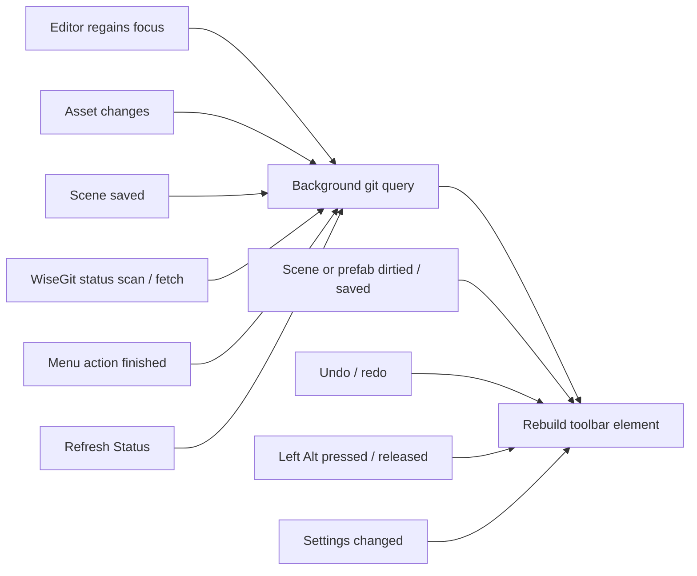

# Git Toolbar

A git status element for Unity's main toolbar. It shows the current branch with a compact, color-coded summary of the working copy, and gives one-click access to common git actions through [WiseGit](https://github.com/NibbleByte/UnityWiseGit).

<p>
  
</p>

The status text follows the format of the zsh [powerlevel10k](https://github.com/romkatv/powerlevel10k) prompt. The icon color gives the overall repository state at a glance.

## Backstory

This small toolbar had been on my mind for a long time. Now that I have access to Claude Code, it seemed like a good use for it. The entire code was vibe coded in a few hours, so it doesn't represent my coding style, just my way of thinking about building a tool.

## Contents

- [Requirements](#requirements)
- [Installation](#installation)
- [Folder structure](#folder-structure)
- [The toolbar element](#the-toolbar-element)
  - [Status text](#status-text)
  - [Icon color](#icon-color)
  - [Tooltip](#tooltip)
- [Actions](#actions)
  - [Right-click menu](#right-click-menu)
  - [Switching branches](#switching-branches)
  - [Stashing](#stashing)
- [Protected branches](#protected-branches)
- [Unsaved scenes and prefabs](#unsaved-scenes-and-prefabs)
- [File locks](#file-locks)
- [When the status updates](#when-the-status-updates)
- [Settings](#settings)
- [Build stamping](#build-stamping)
- [Third-party support](#third-party-support)
- [Implementation notes](#implementation-notes)
- [Limitations](#limitations)
- [Troubleshooting](#troubleshooting)
- [Credits](#credits)
- [License](#license)
- [Credit in your game](#credit-in-your-game)
- [Projects using Git Toolbar](#projects-using-git-toolbar)
- [Contributing](#contributing)
- [Roadmap](#roadmap)

## Requirements

| Requirement | Notes |
|---|---|
| **Unity 6.3 or newer** | Uses the `MainToolbarElement` API introduced in Unity 6.3. Tested on 6000.5.7f1. |
| **git 2.35 or newer** on `PATH` | Needed for `git status --show-stash`. With an older git the element stays hidden. |
| **[WiseGit](https://github.com/NibbleByte/UnityWiseGit)** | Provides the git process helpers, the status database and the menu actions. Referenced through its `DevLocker.VersionControl.WiseGit` assembly. |
| **A WiseGit client** | TortoiseGit, SnailGit, RabbitVCS or the command line, set in **Assets → Git → Git Preferences**. Without one, WiseGit menu actions do nothing. |
| **Git LFS** *(optional)* | Only needed for [file locks](#file-locks). |

## Installation

1. Install [WiseGit](https://github.com/NibbleByte/UnityWiseGit) and choose a client in its preferences.
2. Clone or download this repository into any folder under `Assets/`, for example `Assets/Git Toolbar/`.
3. Optional, for [build stamping](BuildStamping.md#setup): add the stamp file to your `.gitignore`.

The element appears in the middle of the main toolbar, next to the Play buttons. If it doesn't, Unity may have added it hidden: right-click the main toolbar and enable **Version Control → Git Status**.

## Folder structure

```
Git Toolbar/
├── README.md                     This document
├── BuildStamping.md              Build stamping documentation
├── LICENSE.md                    MIT license with the Commons Clause
├── Documentation~/               Images for the documents (ignored by Unity)
├── Editor/                       GitToolbar.Editor assembly (editor only)
│   ├── GitToolbar.Editor.asmdef
│   ├── GitBranchStatus.cs        The toolbar element: text, icon, tooltip, menus, refresh logic
│   ├── GitRepoStatus.cs          Runs git, parses its output, runs switch / stash commands
│   ├── GitToolbarSettings.cs     Project settings and the Project Settings page
│   ├── GitBuildStamp.cs          Build hooks for build stamping
│   ├── ParrelSyncSupport.cs      Optional ParrelSync clone detection, via reflection
│   ├── ToolbarLabelWidth.cs      Removes Unity's 120px toolbar label width cap
│   ├── ToolbarTooltip.cs         Updates an open tooltip in place
│   ├── LeftAltKey.cs             Reads the Left Alt key state from the OS
│   └── Resources/
│       └── GitToolbarIcon.png    Base icon, tinted per state
└── Runtime/                      GitToolbar.Runtime assembly (included in builds)
    ├── GitToolbar.Runtime.asmdef
    └── BuildGitInfo.cs           Runtime access to the build stamp
```

| Assembly | Platforms | References | Auto-referenced |
|---|---|---|---|
| `GitToolbar.Editor` | Editor | `GitToolbar.Runtime`, `DevLocker.VersionControl.WiseGit` | No |
| `GitToolbar.Runtime` | All | — | Yes, so game code can use `BuildGitInfo` |

All code is in the `GitToolbar` namespace.

> [!IMPORTANT]
> `Editor/Resources/GitToolbarIcon.png` must keep **Read/Write** enabled in its import settings. The toolbar tints copies of it for each state.

## The toolbar element

The element is registered as **Version Control/Git Status**. Hold <kbd>Ctrl</kbd> and drag to move it; Unity remembers the position.

- **Left-click** opens WiseGit's **Show Log** for the repository.
- **Right-click** opens the [actions menu](#right-click-menu).
- **Hover** shows the [tooltip](#tooltip).

### Status text

The branch name, followed by counters that only appear when they're non-zero:

```
⚠ develop ⇣1⇡2 *1 merge ~1 +2 !5 ?4 ◌1 🔒2
```

| Symbol | Color | Meaning |
|---|---|---|
| `⚠` |  red | Current branch is [protected](#protected-branches). |
| `develop` | default | Current branch. In a detached HEAD state, the short commit instead: `@9ba2400`. |
| `⇣N` |  yellow | Commits behind the upstream, i.e. to pull. Based on the last fetch. |
| `⇡N` |  blue | Commits ahead of the upstream, i.e. to push. |
| `*N` |  cyan | Stashes. |
| `merge`, `rebase 2/5`, … |  red | Operation in progress: `merge`, `rebase` (with progress), `am`, `cherry-pick`, `revert`, `bisect`. |
| `~N` |  red | Conflicted files. |
| `+N` |  green | Staged files. |
| `!N` |  orange | Modified files, not staged. |
| `?N` |  violet | Untracked files. |
| `◌N` |  magenta | [Unsaved scenes and prefabs](#unsaved-scenes-and-prefabs). |
| `🔒N` | default | [Locked files](#file-locks). |

> [!NOTE]
> Counts cover the whole repository, not just `Assets/`. Untracked files are counted with git's default mode, so a new untracked folder counts as one entry.

### Icon color

The git icon is tinted by the most urgent state. When several apply, the first match in this table wins:

| Icon | Color | State |
|:---:|---|---|
|  |  **Red** | Conflicts, or a merge / rebase / cherry-pick / revert / bisect in progress. |
|  |  **Orange** | Uncommitted changes: staged, modified or untracked files. |
|  |  **Gray** | No upstream: a local-only branch or a detached HEAD. |
|  |  **Magenta** | Diverged: both ahead of and behind the upstream. |
|  |  **Blue** | Ahead: commits to push. |
|  |  **Yellow** | Behind: commits to pull, as of the last fetch. |
|  |  **Green** | Clean and in sync with the upstream. |

The light editor theme uses a darker variant of each color so text stays readable on the light toolbar. The images in this document show the dark theme.

### Tooltip

<table>
  <tr>
    <th>Normal</th>
    <th>With <kbd>Left Alt</kbd> held</th>
  </tr>
  <tr>
    <td valign="top"></td>
    <td valign="top"></td>
  </tr>
</table>

From top to bottom:

1. **Branch → upstream**, the overall state with its color, and a warning on protected branches.
2. **Details**: one line per non-zero counter, plus the names of unsaved scenes and prefabs.
3. **Remote**: the tracked remote and its URL, shortened (`https://` and `.git` removed). Credentials embedded in the URL are never shown.
4. **Last commit**: author and time.
5. **Locks**, when there are any, grouped by kind (see [file locks](#file-locks)).
6. **Color key**, only while <kbd>Left Alt</kbd> is held. If the tooltip is already open, it updates in place when you press or release the key.

Unity limits tooltips to 300px wide, so long lines wrap.

## Actions

Actions that open a dialog or window (Commit, Show Log, Pull, …) are WiseGit actions and go through the client configured in WiseGit's preferences. Switching branches and stashing run git directly.

### Right-click menu

```
Commit…
Show Log
Check Changes…
────────────
Pull  ⇣1
Push  ⇡2
Fetch
Merge…
────────────
Resolve Conflicts…
Revert…
────────────
Switch To          ▸  feature∕login, main, …
Switch Branch…
Stash              ▸  Stash Changes
                      Stash Changes (Include Untracked)
                      Pop Latest
                      ────────────
                      stash@{0}  WIP on develop: …  (5 minutes ago)  ▸  Apply / Pop / Drop…
Repo Browser
────────────
Copy Branch Name
Git Preferences…
Toolbar Settings…
────────────
Refresh Status
```

Unity appends its own toolbar entries after **Refresh Status**.

<details>
<summary><b>What each item does, and when it's enabled</b></summary>

| Item | Action | Enabled when |
|---|---|---|
| Commit… | WiseGit commit dialog for the whole repository. Asks for confirmation on a protected branch. | There are changes. |
| Show Log | WiseGit log for the repository. Same as left-click. | Always. |
| Check Changes… | WiseGit changes window for the repository. | Always. |
| Pull | WiseGit pull. Shows `⇣N` when behind. | Always. |
| Push | WiseGit push. Shows `⇡N` when ahead. | Always. |
| Fetch | WiseGit fetch. | Always. |
| Merge… | WiseGit merge. | Always. |
| Resolve Conflicts… | WiseGit resolve for all conflicts. | There are conflicts or an operation is in progress. |
| Revert… | WiseGit revert dialog for the repository. | There are changes. |
| Switch To ▸ | Up to 10 local branches, most recently committed first. See [switching branches](#switching-branches). | Not in Play mode. Shows a disabled placeholder when there are no other local branches. |
| Switch Branch… | WiseGit's own switch dialog, for any branch. | Always. |
| Stash ▸ | See [stashing](#stashing). | Not in Play mode. |
| Repo Browser | WiseGit repo browser at the upstream branch. | The branch has an upstream. |
| Copy Branch Name | Copies the branch name (or the commit, when detached) to the clipboard. | The status has been read. |
| Git Preferences… | Opens WiseGit's preferences. | Always. |
| Toolbar Settings… | Opens **Project Settings → Git Toolbar**. | Always. |
| Refresh Status | Re-reads git status now. | Always. |

</details>

> [!IMPORTANT]
> WiseGit's **Pull**, **Push**, **Fetch** and **Merge** keep Unity frozen until the external git tool closes. This is intentional in WiseGit: Unity importing assets while git rewrites files can corrupt asset GUIDs.

### Switching branches

**Switch To ▸** runs `git switch <branch>` without leaving Unity:

1. If there are uncommitted changes, it explains what git will do and asks before continuing. Git carries changes over when it can, and refuses to switch when they would be overwritten.
2. It offers to save modified scenes, then saves assets.
3. It runs git on the main thread with a progress bar. Unity can't import anything while files change.
4. It refreshes the asset database.

If git fails, the error is shown in a dialog. Slashes in branch names are displayed as `∕`, because `/` would create a submenu.

### Stashing

| Item | Command | Enabled when (outside Play mode) |
|---|---|---|
| Stash Changes | `git stash push` | There are staged or modified tracked files. |
| Stash Changes (Include Untracked) | `git stash push --include-untracked` | There are any changes. |
| Pop Latest | `git stash pop` | A stash exists. |
| *stash* ▸ Apply | `git stash apply stash@{N}` | Always. |
| *stash* ▸ Pop | `git stash pop stash@{N}` | Always. |
| *stash* ▸ Drop… | `git stash drop stash@{N}`, after confirmation | Always. |

Each existing stash gets its own submenu, labeled with its ref, message (first 50 characters) and age. All stash items are disabled in Play mode.

Commands that change files follow the same steps as switching branches: save, run git with Unity held, refresh assets. The asset database is refreshed even when git fails, because a pop with conflicts still changes files. Drop doesn't touch the working copy, so it skips the save prompt and the refresh.

> [!WARNING]
> **Include Untracked** also stashes new assets and their `.meta` files. They disappear from the project until the stash is applied or popped.

## Protected branches

Branches that shouldn't receive direct commits, such as `main` or release branches.


On a protected branch:

- the text starts with a red `⚠`
- the tooltip says the branch is protected
- **Commit…** in the right-click menu asks **Commit Anyway / Cancel** first

The list is a project setting, so the whole team shares it. Defaults are `main`, `master` and `release/*`. `*` matches any characters, so `release/*` covers `release/1.4` and `release/hotfix`. Matching is exact and case-sensitive.

Commits made outside Unity (terminal, git client, IDE) aren't affected. This is a reminder, not enforcement. Use your git host's branch protection to actually block pushes.

## Unsaved scenes and prefabs

Changes that only exist in memory are invisible to git until saved. The `◌N` counter shows how many open documents have unsaved changes, and the tooltip lists them by name:

```
◌2  unsaved, git can't see these yet: Main (scene), Player (prefab)
```

It counts loaded scenes with unsaved changes, and the prefab open in Prefab Mode. It updates immediately when something becomes dirty, is saved, or is opened or closed, with no git call involved. Other unsaved assets (materials, ScriptableObjects, …) aren't detected.

## File locks

When the repository uses Git LFS file locking, `🔒N` shows the number of locked files that WiseGit knows about. The tooltip lists them in four groups:

| Group | Color | Meaning |
|---|---|---|
| Locked by you |  green | Others can't change these until you push or release them. |
| Locked by others |  red | Don't edit these; your changes can't be pushed. Shows who holds each lock. |
| Stolen |  red | You locked these, but someone else holds the lock now. |
| Broken |  red | Your lock is no longer valid; someone stole and released it. |

Each entry shows the file path, the owner (for locks held by someone else) and how long ago it was locked. Up to 5 files are listed per group, followed by "… and N more".

Lock information comes from WiseGit's status database, so the toolbar doesn't query the LFS server itself. For locks to appear:

- the repository must have LFS-tracked, lockable files, and
- WiseGit must fetch remote changes (WiseGit preferences).

## When the status updates

Git is queried on a background thread, so the editor never waits for it. Requests made while a query is running are merged into a single follow-up query.



| Trigger | Runs git | Why |
|---|---|---|
| Editor regains focus | Yes | Catches commits, checkouts and pulls done in a terminal, git client or IDE. |
| Asset changes (`projectChanged`) | Yes | New, deleted or modified files. |
| Scene saved | Yes | A save changes a file on disk. |
| WiseGit status scan or fetch finished | Yes | Fetches update the behind count and lock data. |
| A menu action finished | Yes | |
| **Refresh Status** | Yes | Manual refresh. |
| Scene or prefab dirtied, saved, opened, closed; undo / redo | No | Only the unsaved counter changes. |
| <kbd>Left Alt</kbd> pressed or released | No | Shows or hides the color key. |
| Settings changed | No | The protected branch list may have changed. |

A full query runs up to six short, local git commands:

| Command | Provides |
|---|---|
| `git status --porcelain=v2 --branch --show-stash` | Branch, commit, upstream, ahead / behind, stash count, file counts |
| `git rev-parse --absolute-git-dir` | Location of `.git`, used to detect an operation in progress |
| `git remote -v` *(when there's an upstream)* | Tracked remote URL |
| `git log -1 --format=%an%x1f%ct` | Last commit author and time |
| `git for-each-ref --sort=-committerdate refs/heads/` | Recent branches for **Switch To** |
| `git stash list` *(when there are stashes)* | Stash entries for the **Stash** menu |

None of them contact the remote server.

## Settings

Open **Edit → Project Settings → Git Toolbar**, or right-click the element → **Toolbar Settings…**


| Setting | Default | Description |
|---|---|---|
| Protected Branches | `main`, `master`, `release/*` | Branch name patterns. `*` matches any characters. |
| Stamp Builds | On | Write the git state into player builds. See [build stamping](BuildStamping.md). |
| Warn On Dirty Build | On | Ask before building with uncommitted changes. Never asks in batch mode. |

Settings are saved to `ProjectSettings/GitToolbarSettings.asset`. The file is created the first time a value is changed; until then the defaults apply. Commit it so the team shares the same settings.

## Build stamping

Every player build records the branch, commit and whether there were uncommitted changes. The game can read this at runtime through `BuildGitInfo.Current`:

```csharp
using GitToolbar;

var git = BuildGitInfo.Current;   // null in the editor
versionText.text = git != null ? $"{Application.version} ({git})" : Application.version;
// 1.4.0 (develop@9ba2400*)
```

Optionally, building with uncommitted changes asks for confirmation first.

**→ [Build Stamping documentation](BuildStamping.md)** covers setup, the full flow, failure handling, runtime behavior and limitations.

## Third-party support

### ParrelSync

[ParrelSync](https://github.com/VeriorPies/ParrelSync) runs extra editor instances on clones of the project for multiplayer testing. Clones share the project's scripts, but a clone folder isn't a git repository.

When ParrelSync is installed, the Git Toolbar detects clone editors and stays hidden there, without running git. ParrelSync is **not a dependency**: `ParrelSyncSupport.cs` looks it up by reflection, so the tool compiles and works the same without it. If a future ParrelSync version changes its API, clone detection is skipped. In that case the element is still hidden in clones, because git fails there, but git keeps being called.

## Implementation notes

The element uses the public main toolbar API (`MainToolbarElementAttribute`, `MainToolbarButton`, `MainToolbar.Refresh`). Two features need behavior the public API doesn't offer. Both use internal editor types through reflection, and both fail safely:

| Feature | Internal API | If a Unity update breaks it |
|---|---|---|
| Full-width status text (`ToolbarLabelWidth.cs`) | `UnityEditor.GUIView.windowBackend.visualTree`, `UnityEditor.Toolbar`. Finds the element's label and removes the stylesheet's 120px `max-width`. | Long status text is cut off with `…`. Everything else works. |
| Tooltip update while hovering (`ToolbarTooltip.cs`) | `UnityEditor.TooltipView` (`s_guiView`, `m_tooltip`, `m_hoverRect`, `hostView`, `Show`) | The color key appears on the next hover instead of immediately. |

Other details:

- **Left Alt** is read from the OS: `GetAsyncKeyState(VK_LMENU)` on Windows, `CGEventSourceFlagsState` on macOS. Unity has no public way to read modifier keys outside GUI events. The key is polled 10 times per second, only while Unity is the active application. On Linux the color key is always shown.
- **Icon tinting** recolors copies of `GitToolbarIcon.png` per state color. The copies are cached and destroyed before each domain reload.
- **WiseGit APIs used:** `GitAsyncOperation` (background thread with main-thread completion), `ShellUtils.ExecuteCommand`, `WiseGitIntegration.ProjectRootNative`, `GitStatusesDatabase` (`DatabaseChanged`, `GetAllKnownStatusData`) and `GitContextMenusManager` for the menu actions.

## Limitations

- **Behind counts are only as fresh as the last fetch.** Use **Fetch**, or let WiseGit fetch in the background.
- **Protected branches only affect commits made from this menu.** They don't block commits made elsewhere, or pushes.
- **Switch To lists local branches only.** Use **Switch Branch…** for remote branches.
- **The unsaved counter only covers scenes and Prefab Mode.**
- **Locks need Git LFS locking and WiseGit remote fetching** (see [file locks](#file-locks)).
- **Tooltips wrap at 300px**, which is Unity's limit.
- **On Windows, tapping <kbd>Alt</kbd> on its own may highlight the editor's menu bar**, which is standard Windows behavior.
- **Two features rely on internal Unity APIs** (see [implementation notes](#implementation-notes)).

## Troubleshooting

| Symptom | Cause / fix |
|---|---|
| The element isn't in the toolbar | It may be hidden: right-click the main toolbar and enable **Version Control → Git Status**. Otherwise git isn't on `PATH`, git is older than 2.35, the project isn't in a repository, or this is a ParrelSync clone. |
| Commit, Pull, Show Log, … do nothing | No WiseGit client is configured. Set one in **Git Preferences…**. |
| The icon is always orange, whatever the state | `GitToolbarIcon.png` lost its **Read/Write** import setting, so it can't be tinted. Re-enable it. |
| Status text ends with `…` | The width workaround stopped working after a Unity update (see [implementation notes](#implementation-notes)). |
| `⇣` count is wrong | It reflects the last fetch. Fetch to update it. |
| `🔒` never appears | No LFS-locked files, or WiseGit isn't fetching remote changes. |
| The color key appears only after re-hovering | The in-place tooltip update stopped working after a Unity update. Re-hovering still works. |
| Holding <kbd>Left Alt</kbd> does nothing | Unity must be the active application. On Linux the key isn't read, and the color key is always shown. |
| Switch or stash fails with a git error | The dialog shows git's message, typically about local changes that would be overwritten. Commit or stash them first. |
| Compile errors about `DevLocker` | WiseGit isn't installed, or its assembly was renamed. The editor assembly references `DevLocker.VersionControl.WiseGit`. |

## Credits

- Git integration: [WiseGit](https://github.com/NibbleByte/UnityWiseGit) by NibbleByte.
- Status format inspired by [powerlevel10k](https://github.com/romkatv/powerlevel10k).
- The toolbar icon is redrawn from the [Git logo](https://git-scm.com/downloads/logos) by Jason Long, licensed under [CC BY 3.0](https://creativecommons.org/licenses/by/3.0/).

## License

[MIT with the Commons Clause](LICENSE.md). The toolbar icon keeps its own [CC BY 3.0](https://creativecommons.org/licenses/by/3.0/) license, see [Credits](#credits).

In short:

- You can use Git Toolbar for free in any project, including commercial games. Shipping a game made with it, build stamp included, is fine.
- You can modify it, fork it and share it, as long as the license file comes along.
- You can't sell it, or sell a product or service whose value comes mainly from it. That includes selling it on an asset store, alone or in a bundle.

The license file is the binding text; this summary is only a guide. Version 0.9.0 beta was released under the plain MIT license, and that release keeps it.

## Credit in your game

Not required, but appreciated: if Git Toolbar helped you make your game, I'd be glad to see a line like this in its credits:

> Git Toolbar by Alireza Tabasi

## Projects using Git Toolbar

If you use this tool in your game or project, let me know by [opening an issue](https://github.com/AlirezaTabasi7/unity-git-toolbar/issues/new) with the project's name and a link. I'd like to list every project that uses it here.

*No projects listed yet.*

## Contributing

Contributions are welcome: bug reports, feature ideas and pull requests. This repository is actively maintained, and issues are fixed on a regular basis.

By submitting a pull request, you agree that your contribution is licensed under the same terms as the rest of the project.

## Roadmap

Planned features, roughly in priority order. Nothing here is implemented yet.

### Git Flow integration

Support for the [git-flow](https://nvie.com/posts/a-successful-git-branching-model/) branching model:

- [ ] **Detection:** read the git-flow configuration (`gitflow.branch.master`, `gitflow.branch.develop`, `gitflow.prefix.*`) and enable the integration only when the repository is initialized for git-flow.
- [ ] **Branch type in the toolbar:** show the git-flow branch type next to the name (feature, release, hotfix, support), with its own color.
- [ ] **Start menu:** right-click → **Git Flow ▸ Start Feature / Release / Hotfix…**, with a small name prompt, branching from the correct base branch.
- [ ] **Finish current branch:** merge back according to git-flow rules (feature → develop; release / hotfix → master and develop, with a version tag), using the same save-run-refresh flow as branch switching.
- [ ] **Publish / track:** push the current git-flow branch and set its upstream.
- [ ] **Automatic protection:** treat the configured master and develop branches as protected, in addition to the protected branch list.
- [ ] **CLI or native:** use the `git flow` command when installed (git-flow-avh or git-flow-next), otherwise run equivalent plain git commands.

### Other planned features

- [ ] **Configurable left-click:** choose in the settings what a left-click does: Show Log (the default), Commit, Pull, Push, Fetch or any other menu action.
- [ ] **GitHub Desktop integration:** use [GitHub Desktop](https://github.com/desktop/desktop) for log, commit, pull and push, as an alternative to WiseGit's configured client.
- [ ] **Color palettes:** pick a palette in the settings, edit its colors and save it as a custom palette. Each palette is its own asset, so it can be shared between projects and teams.
- [ ] **Customizable symbols:** override the status symbols (`⇣ ⇡ * ~ + ! ? ◌ 🔒` and the others) in the settings.
- [ ] **Context-aware left-click:** an optional mode where the left-click does what fits the current state, like GitHub Desktop's main button: Commit when there are changes, Pull when behind, Push when ahead, Publish when the branch has no upstream. The tooltip names the action.
